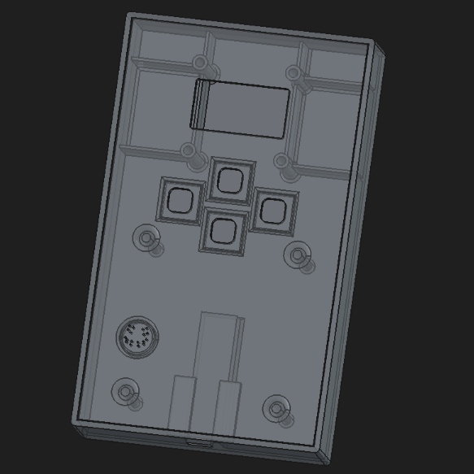

## PONGO
> A simple two part console encolsure, designed for Arduino Nano, 12mm buttons and 1.3" OLED Display. Also uses custom button keycaps.

---

### What is PONGO?
PONGO is a very simple programmable handheld console, It containes 4 12mm Buttons (Connected to Pins 2-5), an 1.3" I2C OLED display (Address 0x3C) and a simple buzzer (Connected to Pin 9). It comes preloaded with a simple game of Pong (Hence the name PONGO). But it can support external games programmed using Arduino IDE.

### Why is PONGO??
Uhh its a cool project that I made in freeCAD (first time using it), and I think that its simple enough that anyone can build it, but expandable enough that it doesn't just sit there as a simple console that plays Pong.

---

That's kinda it for this project, for screws, it uses M2 screw inserts, this has not been tested and may not work properly tho so idk. Tell you in Week 7 if it does :)
